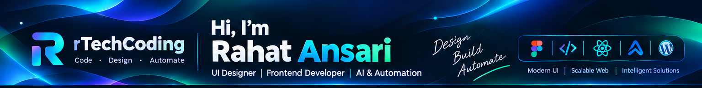
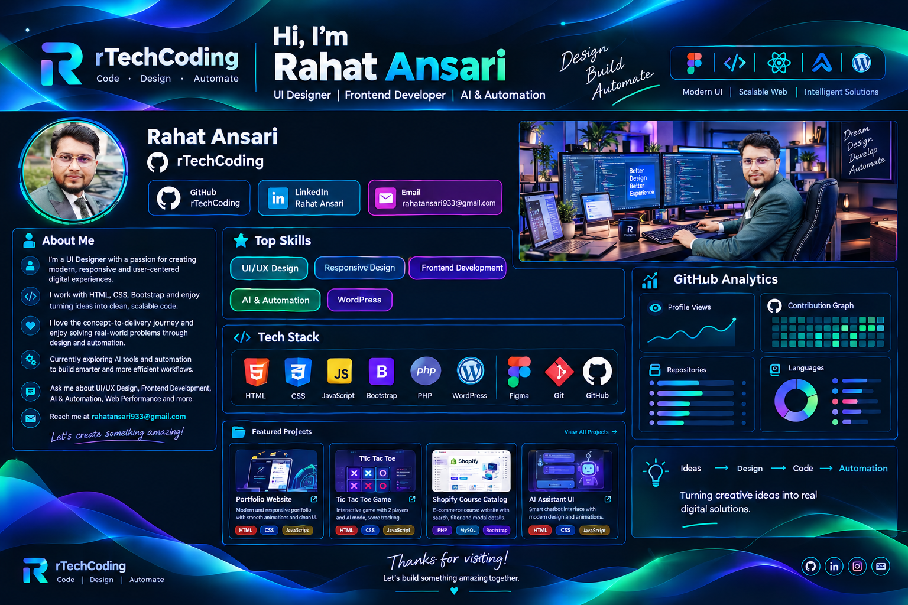
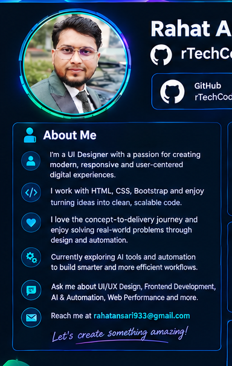
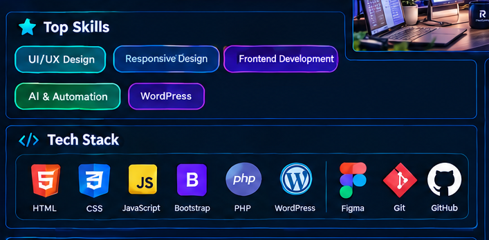
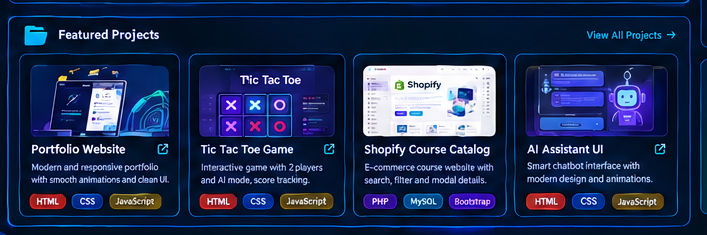
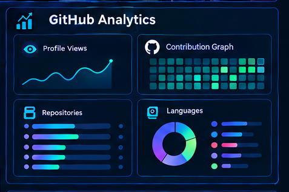
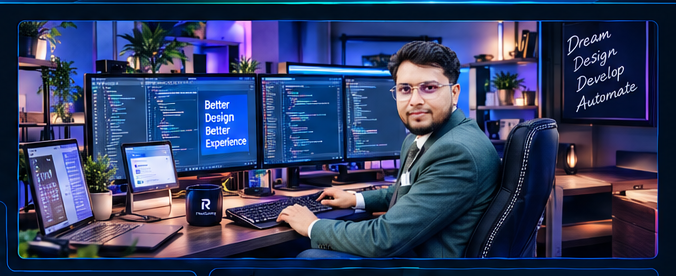
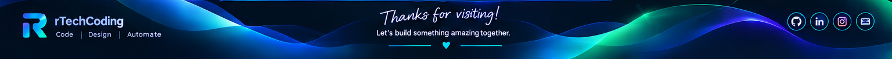

# Rahat Ansari — rTechCoding

**UI Designer | Frontend Developer | AI & Automation**

---

## Profile Design Preview

The image below preserves the supplied design exactly as provided. The sections after it recreate the same profile content in GitHub-friendly Markdown and HTML.

  

---

## About Me

<table>
  <tr>
    <td width="58%" valign="top">

- I'm a **UI Designer** with a passion for creating modern, responsive and user-centered digital experiences.
- I work with **HTML, CSS, Bootstrap** and enjoy turning ideas into clean, scalable code.
- I love the concept-to-delivery journey and enjoy solving real-world problems through design and automation.
- Currently exploring **AI tools and automation** to build smarter and more efficient workflows.
- Ask me about **UI/UX Design, Frontend Development, AI & Automation, Web Performance** and more.
- Reach me at **[rahatansari933@gmail.com](mailto:rahatansari933@gmail.com)**.

  <em>Let's create something amazing!</em>

    </td>
    <td width="42%" align="center" valign="middle">
      
    </td>
  </tr>
</table>

## Top Skills

## Tech Stack

  

## Featured Projects

<table>
  <tr>
    <td width="25%" valign="top" align="center">
      
      <strong>Portfolio Website</strong> 
      Modern and responsive portfolio with smooth animations and a clean UI.
    </td>
    <td width="25%" valign="top">
      **Tic Tac Toe Game** 
      Fun interactive game with two-player and AI modes, plus score tracking.
    </td>
    <td width="25%" valign="top">
      **Shopify Course Catalog** 
      E-commerce course website with search, filtering, and course details.
    </td>
    <td width="25%" valign="top">
      **AI Assistant UI** 
      Smart chatbot interface with AI integration concepts and modern design.
    </td>
  </tr>
</table>

[Explore all repositories on GitHub →](https://github.com/rTechCoding?tab=repositories)

## GitHub Analytics

  

  

## Design Workflow

  
  <h3>Ideas → Design → Code → Automation</h3>
  
Turning creative ideas into real digital solutions.

## Let's Connect

**Thanks for visiting! Let's build something amazing together.**

